# SkullBot — Good writing has good bones.

A writing studio for ideas, clearer drafts, source review, and academic documents. **Chat, paraphrase, proofread, summarize, organize citations, format APA papers, and inspect similarity in one workspace.**

[Open the private app](https://skullbot-writing-lab.adam-vamshikrishna.chatgpt.site) · [Run locally](#run-locally) · [Product showcases](#product-showcases-with-real-examples) · [Architecture](docs/detection/ARCHITECTURE.md) · [Verification](docs/detection/VERIFICATION.md)

[](https://github.com/vams2krish/SkullBot-GenAI-Writing-Studio/actions/workflows/check.yml)

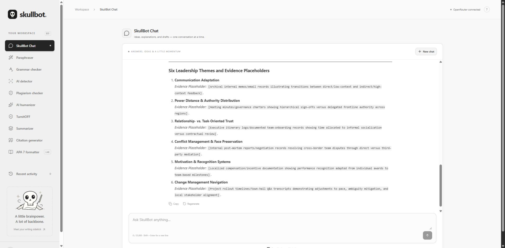

The hosted app is owner-private; this source repository is public. The optional Python detection service currently runs **locally**, by the owner's choice. Hosted fingerprint matching works without it; hosted neural and semantic results accurately show unavailable until a reachable backend is connected.

## Everything in the workspace

| Feature | What you can do | How it runs |
| --- | --- | --- |
| **SkullBot Chat** | Ask questions, develop outlines, follow up, copy/regenerate answers, stop generation, start a new chat | OpenRouter; optional device chat storage |
| **Paraphraser** | Standard, Fluency, Humanize, Formal, Academic, Simple, Creative; rewrite intensity 0–100 | OpenRouter |
| **Grammar checker & red squiggles** | Review spelling/basic grammar, choose replacements, ignore terms; request an AI grammar pass | Local dictionary/rules plus optional OpenRouter correction |
| **AI humanizer** | Basic/Advanced natural-voice editing, or **Rules (local)** | OpenRouter for Basic/Advanced; deterministic rules for local mode |
| **TurnitOFF** | Apply inspectable rules, protect terms/math/code/citations, constrain word growth, inspect every edit | Browser-local, zero generative AI; 27 bundled rules |
| **Document processing** | Edit eligible prose/runs/comments in documents and mixed ZIPs while auditing preservation | Local parsers, XML checks and archive limits |
| **ZipPy lab** | Compare actual gzip size, byte entropy, sentence variation and 3/4/5-gram overlap | Descriptive local measurements |
| **Summarizer** | Short, Medium, Long, Detailed summaries with length checks | OpenRouter; labeled extractive fallback |
| **Plagiarism checker** | Fingerprint matching, ranked sources, exact highlights, exclusions and opt-in repository comparisons | Local device matching or private Python service |
| **Semantic review** | Find meaning-similar passages using embeddings, with source IDs/offsets | Optional Python model service; separate from exact coverage |
| **AI detector** | Independent experimental transformer indicator, projected sentence highlights and abstention | Optional Python classifier; English baseline, minimum prose length |
| **Citation generator** | Webpage/book/journal APA templates, alphabetical reference library and in-text forms | Manually supplied source metadata |
| **TurnitOFF citation engine** | Explicit source markers, hierarchical subject labels, APA/IEEE/BibTeX/LaTeX/JSON exports | Deterministic; no invented source discovery |
| **APA 7 formatter** | Student/professional metadata, content preview and formatted DOCX | Server-side document generation |
| **Workspace controls** | Copy/download, use result as draft, recent activity, optional saving, clear workspace, responsive navigation | Browser/device storage; no cross-device sync |

## Product showcases with real examples

The screenshots below are fresh captures of the running product using synthetic classroom/test examples. Generated responses are actual observed outputs, not mockups; another model run can differ. Examples demonstrate functionality, not factual correctness or detector accuracy. [Screenshot gallery and provenance](docs/showcase/README.md).

### 1. Turn an assignment into a research conversation

**Use case:** a student needs to plan a 2,500-word case study about a leader across cultures using Yin's method and APA 7.

Try:

> Outline a 2,500-word case study of a leader across cultures using Yin’s method. Give six leadership themes and evidence placeholders. Do not invent sources or interviews.

The observed answer organized a case-study design and named six themes: communication adaptation, power distance, relationship/task-oriented trust, conflict management, motivation/recognition, and change management. Evidence remained explicitly marked as placeholders. Follow up with:

> Turn the outline into a five-step research checklist. Identify which sources and evidence I still need to supply.

Chat supports Markdown answers, follow-ups, copy, regenerate, stop/retry, and optional device storage. It does not browse the web or verify references. Prompted length goals are not hard guarantees.

### 2. Rephrase an academic draft

Choose **Paraphraser → Academic** and adjust rewrite intensity.

**Input used in the live showcase:**

> Our team studied how leaders work across cultures. We compared interview notes with public documents and considered alternative explanations before drawing conclusions.

**Observed output:**

> We examined how leaders operate across cultures by comparing interview notes with public documents and considering alternative explanations before drawing conclusions.

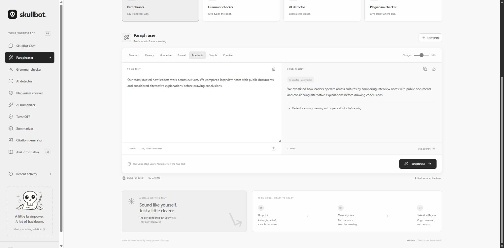

The other modes offer different registers. Intensity zero is preserved as zero; it requests minimal editing rather than disabling the model. Review meaning, nuance, quotations and attribution after every rewrite.

### 3. Catch errors with red squiggles

Paste:

```text
i recieve teh report and keep seperate notes. The researcher have evidence.
```

Red wavy underlines identify spelling/basic grammar issues in the editor. Open a suggestion to replace a span or ignore a term. One live AI pass returned the following (it also changed the tense, so review the intended time frame):

```text
I received the report and kept separate notes. The researcher has evidence.
```

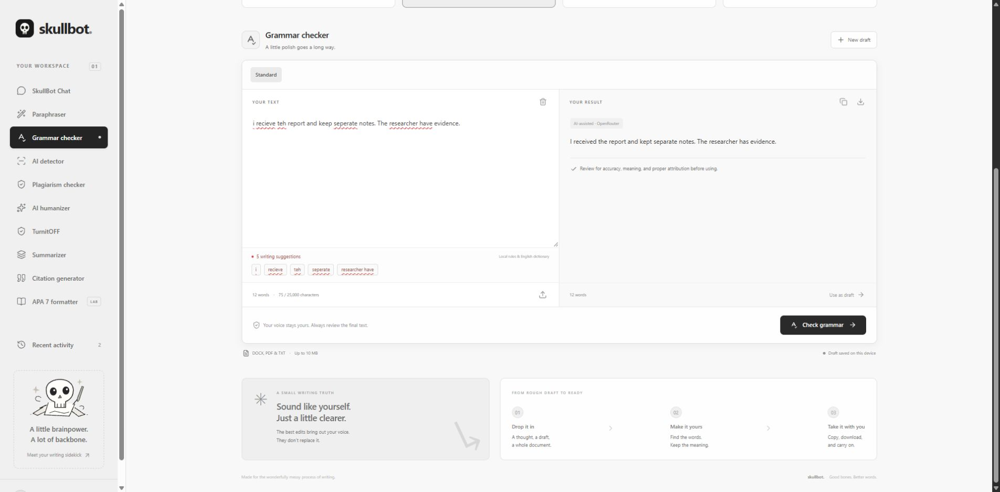

The local pass is deliberately narrower than a complete grammar model. For example, the deterministic grammar function corrects `i recieve teh report and keep seperate notes.` to `I receive the report and keep separate notes.`; broader agreement correction uses the AI pass or targeted editor suggestions.

### 4. Choose model editing or a deterministic Humanizer pass

**Basic / Advanced** request natural-voice editing through OpenRouter. **Rules (local)** uses the same inspectable engine as TurnitOFF.

Actual deterministic example:

```text
Before: Furthermore, we utilize evidence in order to evaluate $E=mc^2$ (Smith, 2024).
After:  Also, we use evidence to evaluate $E=mc^2$ (Smith, 2024).
```

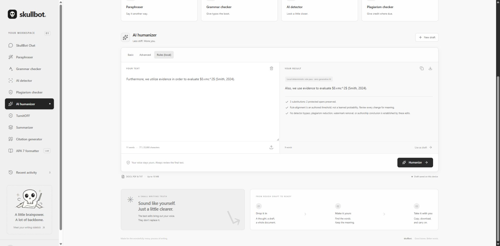

The equation and citation are unchanged. `Smith, 2024` is a synthetic preservation-test marker, not a supplied or verified reference. Humanizer editing does not establish detector evasion.

### 5. Condense a long research draft

Use **Summarizer → Short / Medium / Long / Detailed**. The result labels whether it came from AI assistance or an extractive fallback.

The fresh screenshot uses a 92-word classroom-methodology draft. Its observed Short result was: “This case study examines cross-cultural leadership without stereotypes, using verified evidence and comparing observed patterns against rival explanations.”

A previous live QA run used the same synthetic 2,836-word cross-cultural leadership research-plan draft:

| Mode | Target words | Observed words | Method |
| --- | ---: | ---: | --- |
| Short | 567 | 558 | AI-assisted |
| Medium | 1,134 | 1,128 | Labeled extractive fallback |
| Long | 1,702 | 1,702 | Labeled extractive fallback |
| Detailed | 2,269 | 2,269 | Labeled extractive fallback |

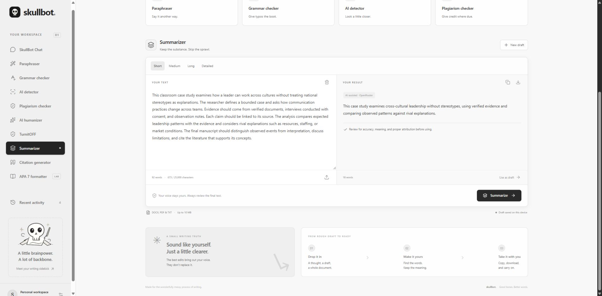

These are individual runs, not universal length or quality guarantees. Out-of-budget or truncated model summaries trigger a labeled fallback built from intact original sentences. See the [original QA report](docs/QA-REPORT.md).

### 6. Make protected, reviewable edits with TurnitOFF

TurnitOFF v1.0.0 is an English literal-rule engine with **27 downloadable rules**, not an LLM paraphraser.

The example above produces three logged edits—`in order to → to`, `utilize → use`, `Furthermore, → Also,`—and preserves two protected spans. Its rule-pass count decreases from **11 to 9 words**.

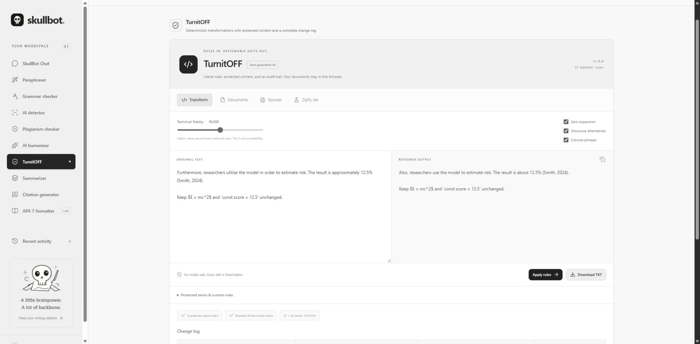

Controls include technical fidelity, zero expansion, discourse/concision switches, protected terms and custom literal JSON rules. Higher fidelity permits fewer authored rules; it is not a learned probability. Zero expansion means the word count cannot increase, not that it stays exactly equal.

For example, protect `utilize` and transform:

```text
We utilize evidence in order to learn.
→ We utilize evidence to learn.
```

An additional custom rule can use this schema:

```json
[{"id":"team-01","from":"prior to","to":"before","stage":"lexical","alignment":99}]
```

Duplicate IDs, empty/multiline phrases, malformed JSON and invalid alignment values are rejected. Math, fenced/inline code, citations, URLs, quotes, numbers and user-protected terms are conservatively masked. Review all edits for meaning. There is no verified detector bypass, semantic-equivalence certification, watermark removal or 4,000-rule catalog.

### 7. Process documents and code without rewriting executable statements

TurnitOFF's **Documents** tab accepts TXT, Markdown, LaTeX, DOCX, ZIP, JS, JSX, TS, TSX, MJS, CJS and Python.

Actual JavaScript example:

```javascript
// Before: Utilize evidence in order to proceed.
const label = "utilize";

// After: Use evidence to proceed.
const label = "utilize";
```

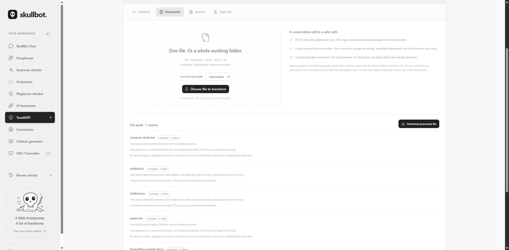

JS/TS/Python parsers identify eligible comments and verify the result; strings, executable text, Python docstrings and tool directives remain intact. Beginner / Intermediate / Architect profiles adjust fidelity thresholds; they do not generate new comments.

DOCX processing edits eligible `w:t` run text while checking XML tags/attributes and retaining other package content. Complex/protected paragraphs are skipped conservatively, including protected phrases split across formatting runs. Unsupported binaries and nested ZIPs are preserved, with per-file failures reported. Metadata is preserved.

Limits: **10 MB upload, 500 archive entries, 20 MB per expanded entry, 50 MB total expanded data**. This does not guarantee arbitrary document rendering or semantic fidelity. [Full TurnitOFF audit](docs/TURNITOFF-AUDIT.md).

### 8. Measure text with ZipPy

The **ZipPy lab** compares original and transformed text using actual gzip bytes, UTF-8 byte Shannon entropy, mean sentence length, sentence-length variation, and original/output 3/4/5-gram Jaccard overlap. Measurements can be exported as JSON.

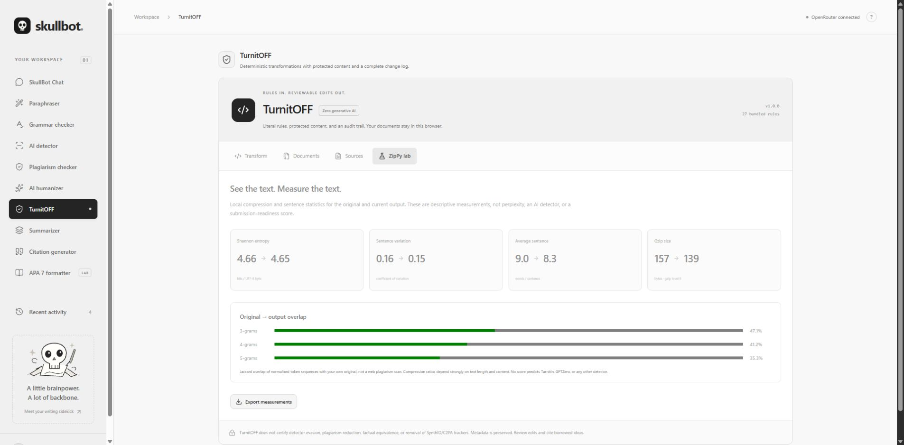

These are descriptive measurements—not language-model perplexity, AI probabilities, a web plagiarism score, or a submission-readiness score. Byte entropy and gzip size depend strongly on text length/content.

### 9. Inspect exact overlap separately from semantic similarity

Paste this same fixture into the submission and a supplied source:

> Culturally responsive leaders listen carefully before making important decisions across national borders.

The hosted fingerprint engine reports **100% exact coverage** for the identical text. Excluding that source and rerunning gives **0%** when no other qualifying source remains. Duplicate/overlapping source matches are unioned rather than double-counted.

The fresh screenshot adds 14 original words after that copied sentence: **12 of 26 eligible words matched (46.15%)**, with the copied span highlighted. The short input correctly receives no AI percentage.

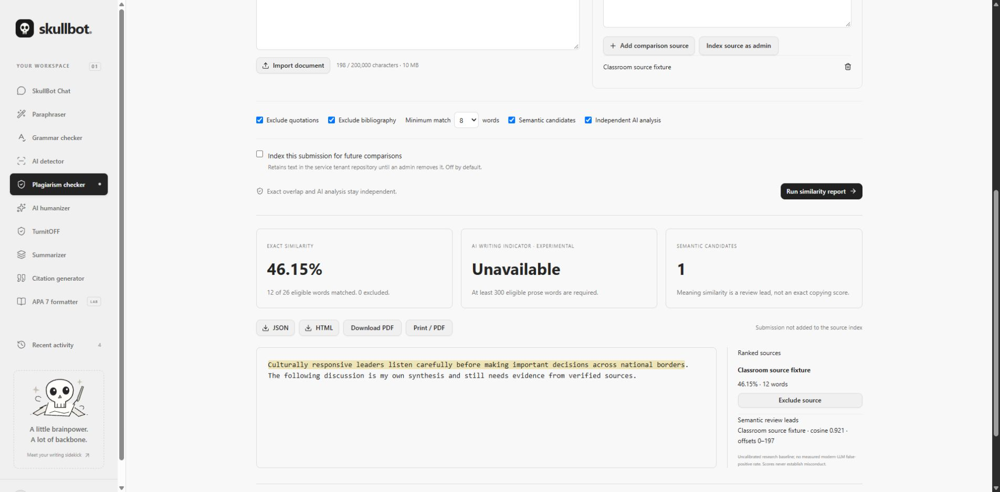

You can exclude quotations, bibliography, small matches or specific sources. Indexing is off by default. Device sources remain on the device; service sources belong to a credential-scoped tenant repository. Institutional settings control member indexing. Self-overlap and shared tenant text are review leads, not misconduct findings.

A real local embedding smoke test used:

- **Source:** “A cross-cultural leader listens carefully before making important decisions. Respectful communication helps international teams work together effectively.”
- **Submission:** “Leaders working across cultures listen attentively before they make major decisions. International teams collaborate more effectively when communication is respectful.”
- **Observed result:** **0% lexical overlap**, one semantic candidate at **cosine 0.8928** using the configured MiniLM model.

Semantic candidates stay separate from exact coverage. This one fixture is not a paraphrase-detection accuracy benchmark. The product does not search Turnitin, the open web, publisher databases or a licensed academic corpus.

### 10. Run an independent, explicitly experimental AI analysis

The local Python service runs actual pretrained classifier weights. The current English baseline is `fakespot-ai/roberta-base-ai-text-detection-v1`; the observed revision is recorded in the [verification report](docs/detection/VERIFICATION.md).

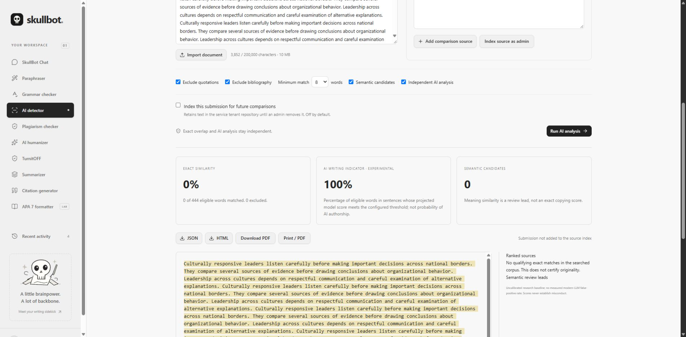

The indicator is the eligible word share in sentences whose projected window-model score meets the configured threshold. It is **not the probability that a person used AI**. Sentence values project overlapping-window scores; they are not independently calibrated sentence probabilities.

- Fewer than 300 eligible prose words: no AI percentage; minimum-length explanation.
- No configured model/service: unavailable, not a fabricated fallback score.
- Unsupported language: the English baseline abstains.
- Exclude a matching source: exact similarity changes independently of the AI result.

Descriptive features and optional reference-LM perplexity are separate signals. No validated modern-LLM false-positive rate, AI-paraphrase accuracy, multilingual AI accuracy or commercial-tool equivalence is claimed. Human review is essential.

### 11. Build references from source records you supply

Enter a book record such as author `Yin, R. K.`, year `2018`, title `Case study research and applications: Design and methods`, publisher `SAGE`.

The current common-source template produces:

```text
Yin, R. K. (2018). Case study research and applications: Design and methods. SAGE.
In-text form: (Yin, 2018)
```

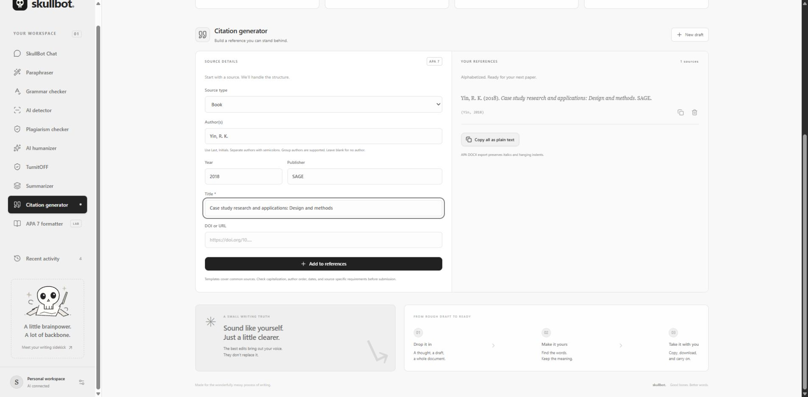

Verify the publication and add source-specific details such as edition where required. Templates support webpages, books and journal articles, multiple/group authors, alphabetical ordering and common italic formatting; they do not verify that a source supports a claim.

In **TurnitOFF → Sources**, organize records by subject and insert explicit markers:

```text
Use a bounded case [[cite:yin2018]].
→ Use a bounded case (Yin, 2018).
```

Markers can resolve to APA, IEEE or LaTeX forms. Export APA/IEEE text, BibTeX, LaTeX or JSON. Taxonomies organize sources across CS/AI, engineering/physics, math/statistics, quantitative finance and medical/life sciences; they do not discover or invent sources. Missing records are retained/reported. Citation insertion is separate from the zero-expansion rule pass and may add words.

### 12. Dress the manuscript in APA 7

Choose **APA 7 formatter → Student** and supply title, author, institution, course, instructor, due date and body. Professional papers add a running head and author note. Preview the content and export DOCX using the citation library.

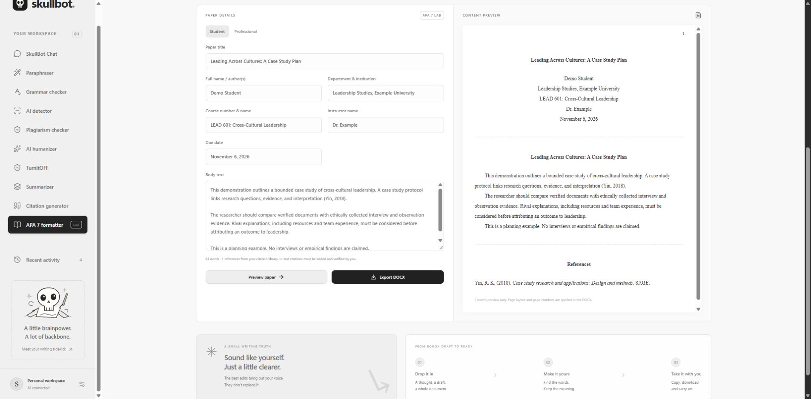

Exports implement US Letter, one-inch margins, Times New Roman 12 pt, double spacing, half-inch first-line body indents, page-number fields, separate title/body/reference starts, alphabetical references and hanging indents. Check the resulting document in Word.

The preview is a content preview, not a Word pagination renderer. Abstracts, complex headings/tables/figures/affiliations and assignment-specific formatting require manual editing. It does not generate a verified 2,500-word case study, enforce an academic rubric, add quotation locators or establish research validity.

## One practical student workflow

1. Use Chat to turn the cross-cultural leadership assignment into an outline and evidence checklist.
2. Collect your own sources/evidence; write the case study and add verified in-text citations.
3. Review red squiggles and use Grammar/Paraphraser for targeted edits.
4. Compare the draft against supplied or opted-in repository sources; review matched spans in context.
5. If you use TurnitOFF, protect technical terms and inspect every deterministic change. Do not treat ZipPy or an AI indicator as clearance for submission.
6. Add verified bibliography records, prepare APA metadata and export DOCX; finish manual APA review in Word.

## Formats and execution boundaries

| Workspace | Import/processing support | Scope |
| --- | --- | --- |
| General writing editor | DOCX, text-based PDF, TXT | 10 MB, 100 PDF pages, 25,000 extracted characters; no OCR |
| Detection, on device | PDF, DOCX, HTML, TXT, MD, TEX | 10 MB, 200 PDF pages, 200,000 characters; extraction offsets refer to extracted text |
| Detection service | PDF, DOCX, PPTX, HTML, RTF, TXT, MD, TEX | Bounded extraction; no OCR or complete reconstruction of all layout/embedded content |
| TurnitOFF | TXT, MD, TEX, DOCX, ZIP, JS/JSX/TS/TSX/MJS/CJS/PY | Eligible prose/runs/comments only; archive and parser audits |
| Report/document export | Writing TXT; APA DOCX; detection JSON/HTML/PDF; citation formats; metric JSON | Server PDF requires detection service; local mode offers browser Print/Save as PDF |

## Run locally

Use **Node.js 24** and npm. Python detection uses **Python 3.11+**.

```powershell
npm ci
if (!(Test-Path .dev.vars)) { Copy-Item .env.example .dev.vars }
npm run dev
```

Set `OPENROUTER_API_KEY` privately in `.dev.vars` for Chat and AI editing; `OPENROUTER_MODEL` defaults to `openrouter/auto`. Never commit or paste keys into chat. Local proofreading, TurnitOFF, extractive summaries, citations, fingerprint matching and APA export do not require an OpenRouter key.

Open the Local URL printed by the server (normally `http://127.0.0.1:5173`). Local previews use a test identity. Forks must register their own Site and replace the hosting identity in `.openai/hosting.json`.

For the optional Python service, use the [setup and deployment guide](services/detection/README.md). It covers private local credentials, actual model downloads/revision pinning, Docker Compose, service configuration, training/evaluation scripts and connecting a reachable backend. Existing `DETECTION_SERVICE_*` entries—including blank placeholders—must be configured locally; the setup helper does not overwrite them.

The current service runs locally by user preference. The hosted Worker cannot reach your laptop's `127.0.0.1`; connect an accessible private API before expecting hosted neural/semantic inference.

## Architecture and source map

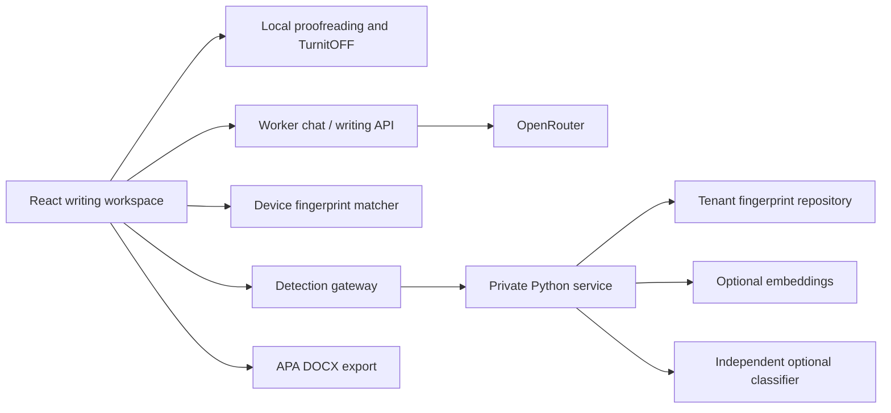

| Location | Responsibility |
| --- | --- |
| `app/page.tsx`, `app/globals.css` | Navigation, editing workspace and responsive theme |
| `components/chat-workspace.tsx` | Multi-turn Chat UI and device storage |
| `components/proof-editor.tsx`, `lib/proofreading.ts` | Red squiggles, dictionary/rules, suggestion ranges |
| `components/turnitoff-workspace.tsx`, `lib/turnitoff/` | Rule catalogs, protection, processors, citations, metrics |
| `components/detection-workspace.tsx`, `lib/detection/` | Reports, exclusions, device matching and imports |
| `app/api/chat/`, `app/api/write/`, `app/api/export/` | Generation/editing and APA document endpoints |
| `app/api/detection/`, `scripts/vite/detection-local-plugin.ts` | Hosted gateway and development-only loopback bridge |
| `services/detection/` | FastAPI, extraction, indexed matching, real optional models, jobs, auth and tests |
| `components/citation-panel.tsx`, `components/apa-panel.tsx`, `lib/apa.ts` | Citation library and APA document generation |

[Full architecture, component design and production roadmap](docs/detection/ARCHITECTURE.md) · [Evaluation/data strategy](docs/detection/EVALUATION.md)

## Privacy, operations and verification

- OpenRouter keys and detection-service credentials stay server-side. Generative editing/Chat send text to OpenRouter and its routed provider.
- TurnitOFF and on-device matching run locally. Connected detection imports/submissions go to the configured Python service; APA export sends paper data to the SkullBot server.
- Chats, drafts, citations and optional device sources use unencrypted browser storage. Detection indexing is off by default. Service reports expire lazily; explicitly indexed source text remains until removed. Removing a report does not remove its indexed source.
- The service has credential-derived tenant/principal roles, bounded queues, rate limits, archive/body bounds and structured request logs. It is a bounded single-instance reference deployment, not institutional SSO or distributed SaaS.
- Keep the hosted Site private. Public multi-user deployment requires user/session authorization, appropriate per-user tenant credentials, quotas, retention/security review and operational infrastructure.

Current verification: **54 JavaScript/TypeScript + 19 Python tests**, TypeScript, production build and both GitHub CI jobs pass. Eight detection import formats were exercised through the UI. Real lexical, embedding and classifier inference completed; a generated PDF was visually reviewed. Docker Compose configuration passed; container execution is unverified because the local Docker daemon is stopped. Browser download-event capture was inconclusive; HTTP report outputs were verified independently.

[Latest verification](docs/detection/VERIFICATION.md) · [TurnitOFF audit](docs/TURNITOFF-AUDIT.md) · [Earlier writing/APA QA](docs/QA-REPORT.md)

## What remains before commercial/institutional equivalence

Licensed source coverage, representative model training/calibration, independently measured error rates, multilingual validation, institutional identity/appeal workflows, durable distributed workers/indexes, strict retention scheduling and deployment/load testing remain necessary. Downloading a classifier or observing a successful demo does not establish Turnitin/QuillBot equivalence. No detector-bypass or watermark-removal guarantee is made.

## License and references

SkullBot source is [MIT licensed](LICENSE). Dependencies and model weights keep their own licenses. In particular, [PyMuPDF/MuPDF uses AGPL or a commercial license](https://pymupdf.readthedocs.io/en/latest/about.html); choose a compliant deployment strategy before proprietary distribution. No commercial dependency license was purchased in this project.

- [OpenRouter chat completions](https://openrouter.ai/docs/api/api-reference/chat/send-chat-completion-request)
- [Fakespot English classifier and score interpretation](https://huggingface.co/fakespot-ai/roberta-base-ai-text-detection-v1)
- [Sentence Transformers similarity](https://www.sbert.net/docs/sentence_transformer/usage/semantic_textual_similarity.html)
- [APA Style paper formatting](https://apastyle.apa.org/style-grammar-guidelines/paper-format)

SkullBot is independent and is not affiliated with QuillBot, Turnitin or the American Psychological Association.
