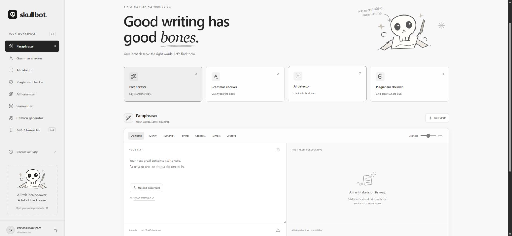

# SkullBot [GenAI / DL-powered application]

**Good writing has good bones.** A monochrome writing studio for turning a rough draft into clear, properly attributed writing. Built with React 19, Next.js-compatible Vinext, Tailwind CSS 4, shadcn/ui, Radix UI, and a Cloudflare Worker backend.



[Open SkullBot](https://skullbot-writing-lab.adam-vamshikrishna.chatgpt.site) · [Source repository](https://github.com/vams2krish/SkullBot-GenAI-Writing-Studio)

The hosted app is private to its owner. This repository is public. Forks need their own server credentials and hosting identity.

## Project classification

**Type: Generative AI application using pretrained deep-learning language models.** SkullBot calls OpenRouter for inference; it does not train or fine-tune its own transformer, DeBERTa, or plagiarism model. It is not an original ML research or model-training project. Local summaries, spelling rules, text overlap, citation templates, and document formatting use deterministic algorithms.

## Features and implementation status

| Tool | What works | Limits |
|---|---|---|
| Paraphraser | Standard, Fluency, Humanize, Formal, Academic, Simple, Creative; rewrite intensity | Requires OpenRouter; review facts and meaning |
| Grammar checker | AI grammar correction; basic local spelling/punctuation fallback without a key | Local fallback is deliberately limited |
| AI humanizer | Basic and Advanced natural-voice editing | Does not guarantee detector evasion |
| Summarizer | Short, Medium, Long, Detailed; AI summaries or local extractive fallback | Summaries require review against the source |
| AI detector | Sentence-level experimental style markers with explanations | **No trained classifier, probability, or authorship determination** |
| Plagiarism checker | Exact normalized five-word source comparison and covered-word percentage | **Only the source supplied by the user; no internet or corpus scan** |
| Citation generator | APA 7 templates for webpages, books, and journal articles; one/two/three-plus author in-text forms; alphabetical library | Manual source details; verify source-specific APA rules |
| APA 7 lab | Student/professional title pages, body, reference list, DOCX export | Experimental formatter, not an automatic rubric grade |
| Document import | DOCX, text-based PDF, TXT; browser-side extraction and drag/drop | 10 MB / 100 PDF pages / 25,000 extracted characters; no OCR |
| Workspace | Copy/download results, use result as draft, 20 recent results, local draft saving, clear data | Browser/device storage; no cross-device sync |

## Product flow

1. Choose a writing tool from a card or the sidebar.
2. Paste text, try the example, or import a document.
3. Pick a mode and, for paraphrasing, the rewrite intensity.
4. Submit. Read the result and its method label, review the meaning, then copy/download or use it as your next draft.
5. Add sources in Citation generator. Authors use `Last, Initials.` separated by semicolons; group authors are accepted. Leave year blank for `n.d.`.
6. Open APA 7 formatter, fill in the title-page details, and include your own verified in-text citations in the body. Preview the content and export a DOCX containing your citation library.
7. Reopen recent activity on the same device, or disable saving in workspace settings.

## Run locally

Use **Node.js 24** and npm.

```sh
npm ci
```

Copy `.env.example` to `.dev.vars`, then set `OPENROUTER_API_KEY` locally. Do not commit this file. `OPENROUTER_MODEL` defaults to `openrouter/auto`; set a supported OpenRouter model ID to pin a particular model.

```sh
npm run dev
```

Open the Local URL printed by the server (normally `http://127.0.0.1:5173`). The Sites portable profile uses a local test identity. The app still supports local grammar, extractive summaries, citations, comparison, detector style analysis, and APA export without a key. Rewriting clearly reports missing configuration instead of fabricating a result.

```sh
npm run typecheck
npm test
npm run build
```

The included Worker/Sites integration preserves hosted sign-in. For a new Sites deployment, register your own Site and replace the existing project identity rather than pushing to this owner's project. Configure runtime secrets through your host. `npm run start` serves the built Worker locally through Wrangler.

## Architecture

```text
React workspace
  ├─ Browser parsing: Mammoth (DOCX), PDF.js (PDF), File API (TXT)
  ├─ Local storage: draft, citation library, bounded activity
  ├─ POST /api/write
  │    ├─ validated tool/mode/text
  │    ├─ deterministic source comparison / style analysis
  │    └─ OpenRouter → selected pretrained model → edited text
  │         └─ local grammar / extractive summary when no key is set
  └─ POST /api/export
       └─ validated paper data → OOXML DOCX attachment
```

| Location | Responsibility |
|---|---|
| `app/page.tsx` | Workspace, tool selection, submission, upload, activity/settings |
| `components/citation-panel.tsx` | Citation entry, reference formatting, library |
| `components/apa-panel.tsx` | Paper metadata, content preview, export form |
| `app/api/write/route.ts` | Validation, OpenRouter inference, local algorithms |
| `app/api/export/route.ts` | Paper validation and DOCX response |
| `lib/writing.ts` | Tool definitions, local algorithms, citation helpers |
| `lib/apa.ts` | Letter layout, headers, title page, paragraphs, references |
| `app/globals.css` | Neutral theme, responsive layout, typography |
| `public/favicon.svg` | Original minimal SkullBot logo |

The interface includes original vector doodles, a skull writing mascot, keyboard-focus styles, accessible button names, responsive navigation, reduced-motion support, and Radix modal focus handling. Heavy document parsers load only on demand. The PDF worker is bundled locally.

## APA 7 export

Exports use US Letter pages, one-inch margins, Times New Roman 12 pt, double spacing, zero extra paragraph spacing, half-inch body first-line indents, and right-aligned header page fields. Student title pages include title, author, institution, course, instructor, and due date. Professional papers add a running head (maximum 50 characters) and author note. The body and References begin on separate pages; references are sorted with half-inch hanging indents and template-based italics.

This tool does not invent sources, automatically link claims to citations, validate quotation page/paragraph locators, infer heading levels, or grade the supplied rubric. It supports common reference templates, not every APA source category. Abstracts, tables, figures, appendices, and complex author affiliations require manual editing. Webpage dates currently use years. Review the exported document in Word and check your assignment instructions.

## Privacy and operations

- `OPENROUTER_API_KEY` stays server-side; the status endpoint returns only a configured boolean.
- AI submission sends your text to OpenRouter and the routed provider. APA export sends paper data to the SkullBot server. File extraction runs in the browser.
- No application database, document archive, analytics, or automatic training collection is enabled. Drafts and citations use this browser's local storage; that storage is not encrypted.
- The private hosted Site relies on the platform's access boundary. **Before deploying a fork publicly with a paid API key, add server authorization, abuse protection, and quotas.** The repository does not implement a public SaaS billing/account system.
- Requests validate the allowed tool/mode and cap text at 25,000 characters. Provider calls time out. UI handles missing credentials, provider errors, empty input, unsupported files, oversized documents, and stale results after draft changes.
- OpenRouter key expiry/credit caps are account settings; they do not remove provider rate limits or credit requirements.

## Verification

Initial verification performed November 5, 2026:

- TypeScript check and production Worker build passed.
- Six focused Node tests passed for normalized overlap, short snippets, grammar/attribution, extractive summaries, non-probabilistic detector labeling, and multiple/group author citation handling.
- Live OpenRouter requests passed for paraphrasing, grammar correction, summarization, and natural-voice editing.
- Source comparison and sentence-marker API results passed; rewrite results rendered in the browser with no console errors observed.
- Citation add/list and APA content preview were exercised in the browser.
- The export endpoint returned a valid DOCX. OOXML checks verified margins, font, double spacing, page fields, page breaks, and hanging indents. DOCX extraction round trip passed.
- Phone layout was visually reviewed at 390 × 844, without horizontal overflow; mobile navigation and tool switching worked.
- **Verification limits:** browser automation did not observe native upload/download events. The PDF parser UI path and final Word-rendered pagination are not visually verified. No classifier accuracy or web plagiarism coverage is claimed.

## Further development

To reach a commercial plagiarism/AI-detection product, integrate a licensed search corpus and a validated classifier with calibration, language coverage evaluation, sentence-level benchmarks, uncertainty reporting, and an appeal/review process. Public multi-user operation also needs persistent per-user storage, authorization, rate limits, and billing. These are separate from this working private writing studio.

## References

- [OpenRouter chat completions documentation](https://openrouter.ai/docs/api/api-reference/chat/send-chat-completion-request)
- [APA Style paper formatting](https://apastyle.apa.org/style-grammar-guidelines/paper-format)
- [APA Style title-page guidance](https://apastyle.apa.org/style-grammar-guidelines/paper-format/title-page)

MIT licensed. SkullBot is an independent application and is not affiliated with QuillBot or the American Psychological Association. Third-party dependencies retain their licenses.
