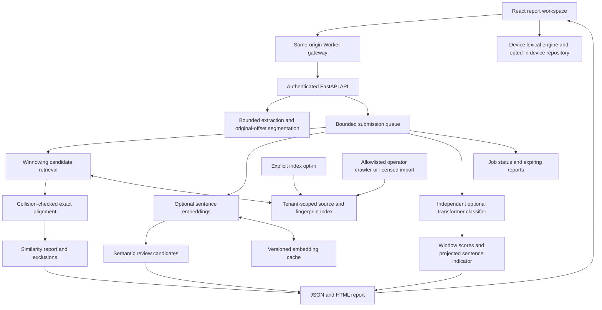

# SkullBot independent detection architecture

## Scope and implementation map

The existing React/Vinext/Cloudflare application is retained. A Python 3.11 FastAPI service handles extraction, repository matching and optional model inference. Browser-local lexical matching remains usable without a service. AI and semantic results are explicitly unavailable until real model services are connected. The legacy writing heuristics are not used to generate AI percentages in this workspace.



## Project structure

```text
app/api/detection/[...path]/route.ts       credential-hiding HTTP gateway
components/detection-workspace.tsx       submission, source, report, repository UI
lib/detection/{lexical,ingest}.ts         bounded local matching and extraction
services/detection/
  skullbot_detection/
    config.py                            environment configuration and bounds
    preprocess.py                        Unicode tokens, offsets, language, segments
    ingestion.py                         PDF/DOCX/PPTX/HTML/RTF/text extraction
    lexical.py                           shingling, winnowing, alignment, coverage
    repository.py                        tenant sources, fingerprints, vectors, jobs
    models.py                            actual optional embeddings/classifier/LM
    api.py                               credentials, queue, CRUD, poll, exports
    reporting.py                         escaped highlighted HTML
  scripts/                               setup, model download, training, evaluation, crawl
  tests/                                 extraction, isolation and pipeline checks
  Dockerfile / compose.yaml              bounded single-instance deployment
docs/detection/                          design, evaluation and production roadmap
```

## Phase 1: ingestion and offsets

All reports refer to the exact extracted Unicode text, not PDF glyphs or DOCX run positions. Python offsets count Unicode code points; browser-local offsets count UTF-16 code units. The viewer explicitly converts Python spans with code-point slicing. Normalization applies NFKC and case folding to individual lexical tokens, preserving original start/end offsets. The JavaScript implementation uses Unicode lowercase rather than full Python casefold; equivalence of special cases such as German ß is not guaranteed across engines.

TXT/MD/TEX require UTF-8. HTML scripts/styles/templates are discarded and are never executed. PDF extraction uses PyMuPDF with page/size bounds and no OCR. DOCX uses python-docx main paragraphs and tables. PPTX extracts text-bearing slide shapes. RTF uses striprtf. Office archives have expansion limits before library parsing. Layout fidelity and multilingual word segmentation remain imperfect; CJK characters are lexical units, not linguistically segmented words. Language detection is heuristic. Tables, bullet lists, fenced code and references are conservatively filtered from AI prose input; imperfect formatting can still affect filtering.

## Phase 2: classic matching

Generate five-token shingles and 64-bit BLAKE2 fingerprints, then choose the rightmost minimum in each four-shingle window. Any identical run of at least `k + w - 1` tokens shares a selected fingerprint (eight at defaults). The SQL inverted index retrieves ranked tenant candidates; exact tuple comparison prevents hash collisions from becoming matches. Alignment grows contiguous equal token sequences in original source/submission space. Defaults ignore runs shorter than eight words. Light paraphrases appear as exact islands; no edit-distance or semantic claim is inferred from those islands.

Coverage is the union of matched eligible token positions divided by all eligible token positions. Duplicate/overlapping sources never double-count overall coverage. Quotes, bibliography and specific sources can be excluded; quotes/references are removed from the denominator. Per-source percentages can sum above overall coverage. Candidate count (100) and repeated-shingle positions (100) are bounded and can reduce recall on pathological corpora. Small matches below the winnowing guarantee can be missed. Index algorithm/configuration changes trigger a full fingerprint rebuild. Versioned sources are immutable; identical same-owner text is deduplicated. Same-principal prior matches and other tenant-source matches surface review leads for self-overlap/collusion, not misconduct conclusions.

## Phase 3: semantic layer

Optional Sentence Transformers models produce normalized embeddings of 100-word chunks. Cosine similarity is computed against every source in the bounded tenant repository; the first 200 chunks per document are considered. Embeddings are persisted by tenant/source/model revision. This reference vector store is SQLite JSON plus exact matrix search, not a distributed ANN database. A configurable cosine threshold (0.83 initially, uncalibrated) yields semantic candidates with source/query offsets. These candidates do not inflate the exact-match percentage. At larger scale replace the vector table/search adapter with Qdrant/FAISS plus tenant filtering, revision migration and retrieval evaluation. A multilingual embedding model requires its own validation before claims are made.

## Phase 4: independent AI baseline

Optional Hugging Face sequence classification uses `trust_remote_code=False` and safetensors, with a pinned model revision and explicit positive-label mapping. At least 300 eligible prose words and detected English are required. Overlapping windows use up to eight sentences/250 words with stride four sentences; token-aware window bounds prevent assigning scores to silently truncated text; oversized sentences are excluded and counted. Window outputs are averaged onto sentences. The document percentage is the eligible word share in sentences meeting the configured model threshold, not the probability that the author used AI. Raw mean model output is also separate. It is uncalibrated; sentence values are projected window scores, not independently validated probabilities.

The optional demonstration classifier `fakespot-ai/roberta-base-ai-text-detection-v1` is a published English RoBERTa classifier. It is not independently calibrated for institutional academic submissions, current model families, or AI-paraphrased writing. An initial GPT-2-era detector smoke test was also run during development and was not selected as the final default. No accuracy or false-positive rate is claimed. Style features include type-token ratio, sentence length variation and mean token length. They are descriptive and never converted into a probability. True reference-LM perplexity is optional and explicitly unavailable unless a causal LM is configured; first-512-token coverage is reported. POS features/token distribution modelling are future work. Models that fail or are absent produce unavailable results, never a fallback invented score.

## Phase 5: API and reporting

- `GET /health`: liveness only; no configuration or credentials.
- `GET /v1/capabilities`: authenticated model/corpus/retention coverage.
- `POST /v1/extract`: bounded multipart upload to extracted text.
- `POST /v1/submissions`: raw text, supplied sources, exclusions and `index_submission=false` → 202/job ID.
- `GET /v1/submissions/{id}`: owner-scoped status and report polling.
- `GET /v1/submissions/{id}/html`: escaped source-highlighted standalone HTML; `/pdf` renders a paginated PDF.
- `DELETE /v1/submissions/{id}`: remove a completed report.
- `GET/POST/DELETE /v1/sources[/{id}]`: tenant metadata/list and admin indexing/removal.

The frontend supports ranked sources, overlapping span highlights, source exclusions with explicit rerun, JSON and HTML export and browser Print/Save as PDF. The Python HTML report includes lexical highlights. The browser HTML export includes source ranking and plain original text; full alignment offsets are in JSON. The service also renders a bounded paginated PDF through PyMuPDF Story; local-only mode uses browser Print/Save as PDF. Webhook delivery is not implemented.

## Phase 6: bounded reference deployment and hardening boundary

SQLite WAL, a bounded ThreadPoolExecutor (2 workers + 16 queued jobs by default), per-credential rate limits and immutable source indexing provide a practical single-instance starting point. This is not a thousands-of-concurrent-submissions deployment. SQLite transactions serialize source limits/version updates. Jobs are persisted; unfinished jobs become failed on restart instead of being silently lost. Completed reports expire lazily on submission/poll; an external cleanup schedule is needed for strict time-based deletion without traffic. Indexed source text persists until explicit removal. Backups and model caches require separate retention/access controls.

Member indexing is disabled unless an institution explicitly enables `DETECTION_ALLOW_MEMBER_INDEXING`; admin opt-in remains available. Credentials map server-side to tenant, principal and admin/member role; caller-supplied tenant IDs are never trusted. The Worker holds one configured tenant credential and exposes it only to the detection service. The hosted Site must remain owner-private: making it public would require per-user authentication/session authorization and per-user tenant credentials in the gateway. API keys are a service integration baseline, not institutional SSO. TLS, disk encryption, managed secret rotation, service network isolation and audited consent policies are deployment requirements, not features silently supplied by this repository.

Logs contain request IDs, route templates, status and latency, not document bodies or keys. Model calls are serialized to bound CPU/memory. JSON/multipart bodies, characters, archives and pages are bounded, but parsers still need process/container resource isolation for hostile files. Docker runs non-root, read-only, with dropped capabilities and CPU/memory limits. No macros or arbitrary uploaded executable code are run. The allowlisted operator crawler observes robots.txt, uses delays, rejects private/reserved DNS and redirects, and restricts content/bytes. It is not an open user URL fetcher; production requires an egress firewall to address DNS rebinding. No publisher content is scraped or licensed by default.

## Phase 7 and true industry-grade path

1. Acquire authorized, representative sources: institutional opt-in repositories, web indexing with provenance/robots/deletion handling and publisher partnerships. Define coverage and update SLAs.
2. Replace static service credentials with OIDC/JWT, roster/role provisioning and audit trails; obtain privacy/security review and tenant-specific retention agreements.
3. Migrate metadata to PostgreSQL, fingerprint postings to OpenSearch/partitioned SQL, objects to encrypted S3-compatible storage and jobs to a durable broker/workers. Use idempotency keys, retries, dead-letter queues and transactional outbox. Add replicas/health/readiness/backups before Kubernetes scaling.
4. Train/calibrate on licensed human academic writing and multiple modern model families, disciplines, prompt types, paraphrased and mixed texts. Keep author/task/model-family-disjoint held-out tests. Evaluate multilingual/non-native cohorts separately.
5. Publish measured recall/precision, false-positive rates with confidence intervals, abstention/coverage, source-retrieval recall, latency and throughput. Red-team common-source quotations, OCR, formulas, multilingual code switching and heavily edited writing.
6. Enable validated model versions behind staged rollout and rollback, independent adjudication feedback and drift monitoring. Feedback must not automatically turn allegations into training labels.

## References

- [Sentence Transformers semantic similarity](https://www.sbert.net/docs/sentence_transformer/usage/semantic_textual_similarity.html)
- [English baseline detector model card and score interpretation](https://huggingface.co/fakespot-ai/roberta-base-ai-text-detection-v1)
- [Original winnowing paper](https://theory.stanford.edu/~aiken/publications/papers/sigmod03.pdf)

## Dependency licensing boundary
PyMuPDF/MuPDF is distributed under AGPL or a commercial license from Artifex; choose a compliant license/dependency strategy before a proprietary institutional deployment. No commercial license was purchased or accepted in this task. The English Fakespot model is published under Apache-2.0; audit all transitive and model/data licenses for the intended deployment. [PyMuPDF licensing](https://pymupdf.readthedocs.io/en/latest/about.html).
