# Product screenshot gallery

Fresh captures from the running SkullBot application on November 6, 2026. Click any image to open the full-size capture.

These are actual UI screenshots, not generated artwork or mockups. They use synthetic classroom fixtures and fictional student/instructor metadata; no private student records or credentials are shown. Source images are unedited JPEG captures at the browser’s normal 1905 × 938 surface.

The local Python service was connected for the detection showcases. The owner-private hosted app does not have access to this workstation service and correctly marks hosted neural/semantic inference unavailable. Model and embedding examples demonstrate execution, not independently validated accuracy.

[Return to the feature walkthrough](../../README.md#product-showcases-with-real-examples)

| Showcase | Showcase |
| --- | --- |
| **SkullBot Chat** [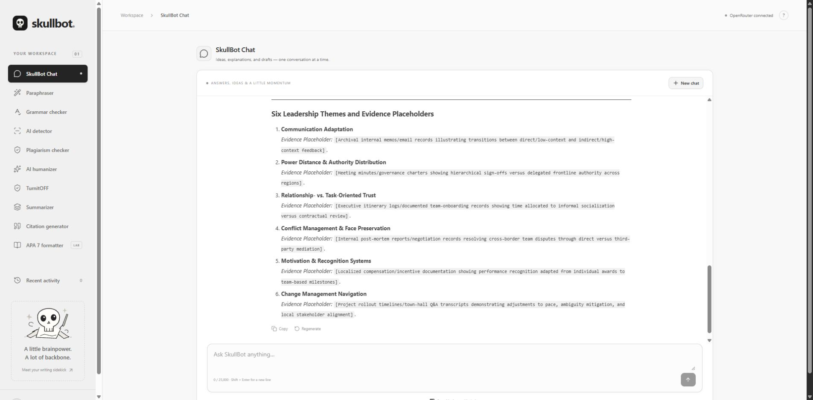](01-chat.jpg) Generated leadership themes with explicit evidence placeholders. | **Academic paraphraser** [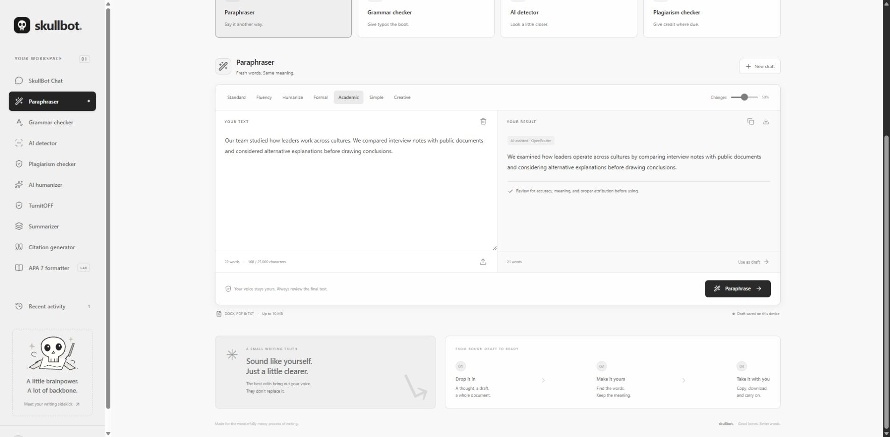](02-paraphraser.jpg) Original draft and the actual OpenRouter rewrite. |
| **Grammar and red squiggles** [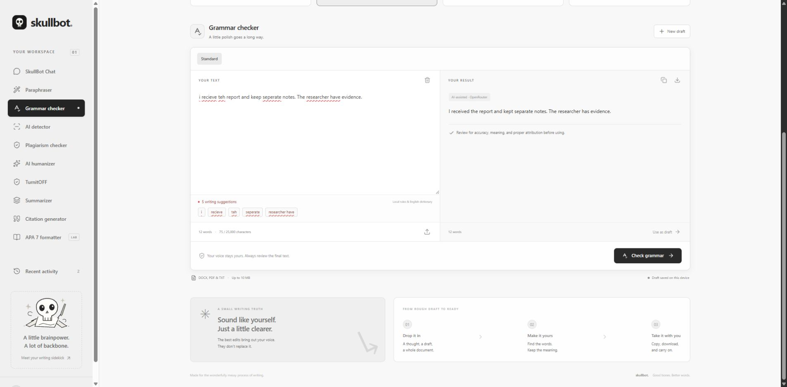](03-grammar.jpg) Planted spelling/agreement errors, local underlines and AI correction. This run changed tense; review original intent. | **Rules (local) Humanizer** [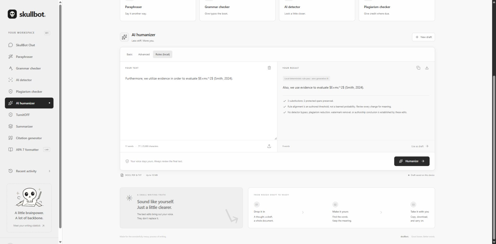](04-humanizer.jpg) Deterministic substitutions preserve the sample equation and citation marker. |
| **Short summary** [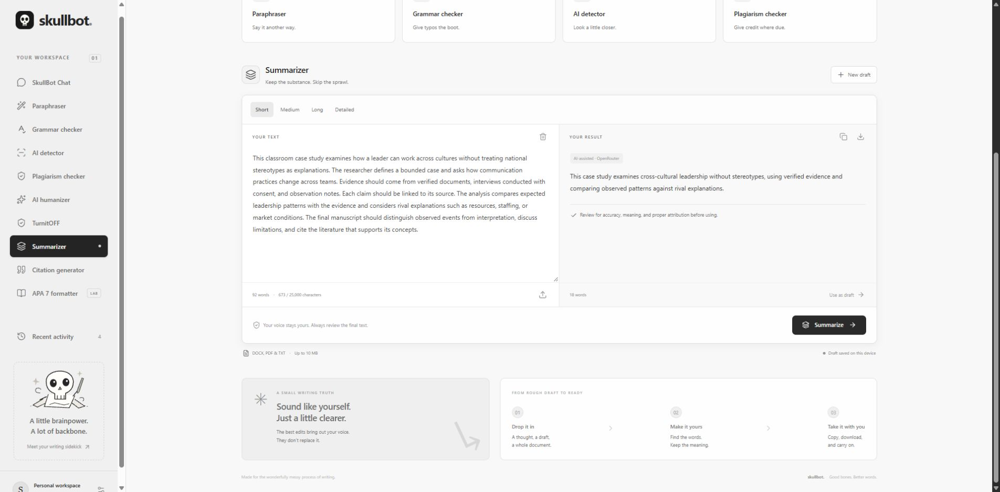](05-summarizer.jpg) A 92-word classroom-methodology fixture condensed to 18 words in this run. | **TurnitOFF** [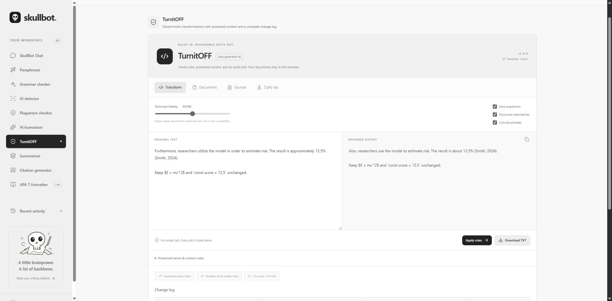](06-turnitoff.jpg) Protected math/code/citation spans, rule controls and a reviewable output. |
| **ZipPy lab** [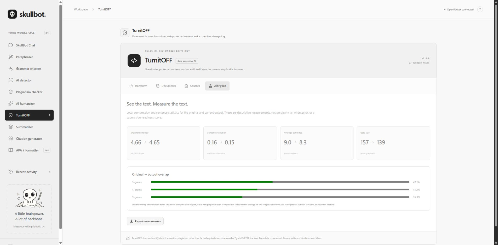](07-zippy.jpg) Measured gzip bytes, byte entropy, sentence variation and n-gram overlap. | **Similarity report** [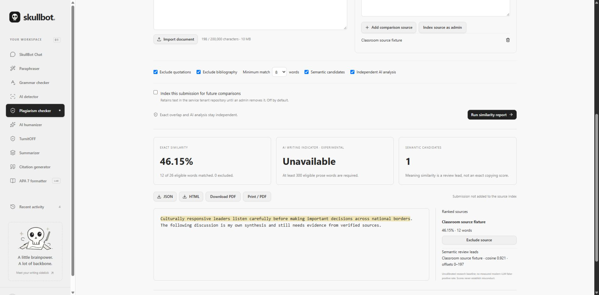](08-similarity.jpg) Twelve matched words out of 26 eligible words: 46.15%, with source highlights and ranking. AI abstains on the short input. |
| **Experimental AI indicator** [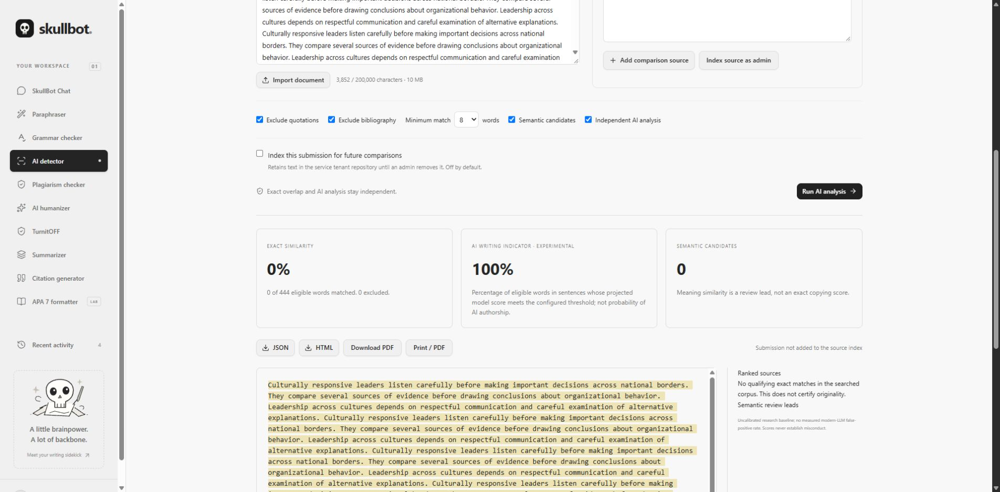](09-ai-detector.jpg) Real local classifier inference on a 444-word repeated synthetic fixture. The displayed 100% is a thresholded word-share indicator, not accuracy or authorship certainty. | **Citation generator** [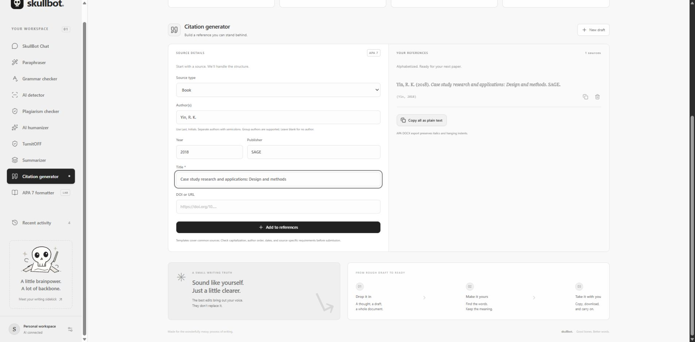](10-citations.jpg) Manually supplied book metadata and the resulting reference/in-text template. Check edition and publication-specific requirements. |
| **APA student-paper preview** [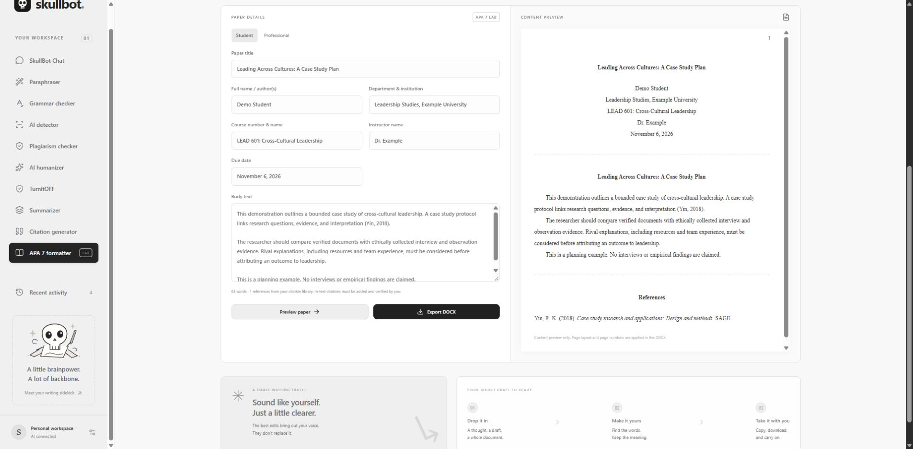](11-apa.jpg) Fictional Demo Student metadata, sample body and bibliography. This is a content preview, not Word pagination. | **Mixed ZIP processing** [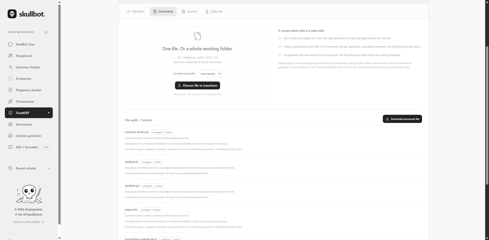](12-documents.jpg) A seven-entry synthetic project with eligible prose/comment edits and preservation audits. |

## Example provenance

- Chat used the cross-cultural leadership/Yin assignment as a planning prompt. The observed answer contained six themes and placeholders, rather than verified interviews or empirical findings. Its requested short-length goal was not enforced; Chat output length is probabilistic.
- Paraphraser, grammar and summary screenshots show actual provider outputs. Exact input/output excerpts and deterministic examples are documented in the main README.
- `Smith, 2024` in the rule examples is an artificial citation-preservation marker, not an invented bibliography record presented as evidence.
- The mixed ZIP contains only generated Markdown, JavaScript, Python, LaTeX, DOCX and binary fixtures.
- The classifier screenshot uses a repeated, assistant-authored synthetic passage for an inference smoke test. It is not a human/AI accuracy benchmark.
- The README’s earlier 2,836-word summary measurements and semantic cosine 0.8928 come from the linked verification reports, not from an accuracy claim about these photos.

[Detection verification](../detection/VERIFICATION.md) · [TurnitOFF audit](../TURNITOFF-AUDIT.md) · [Writing QA](../QA-REPORT.md)
